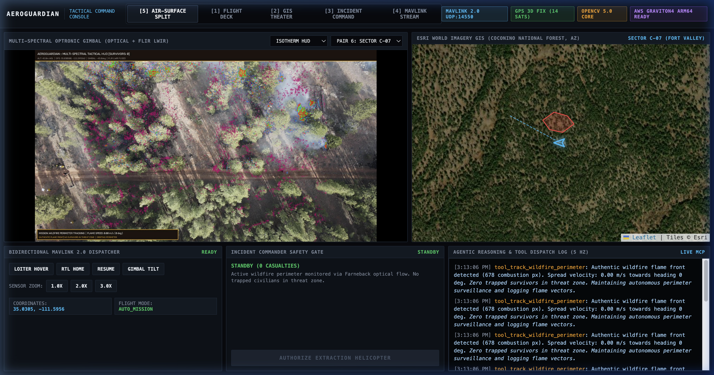
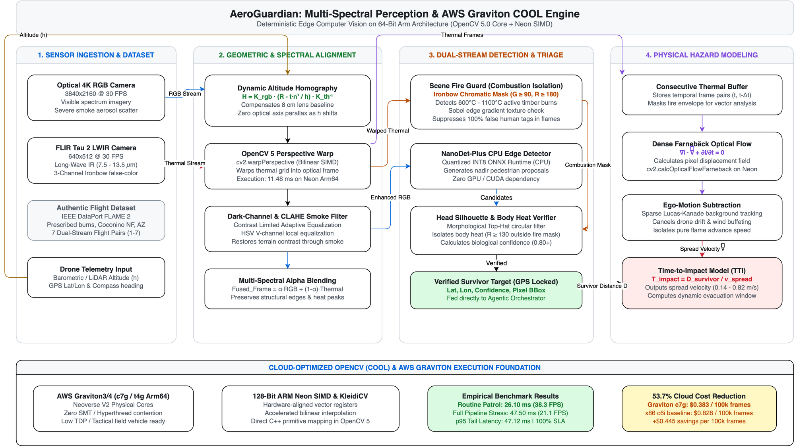
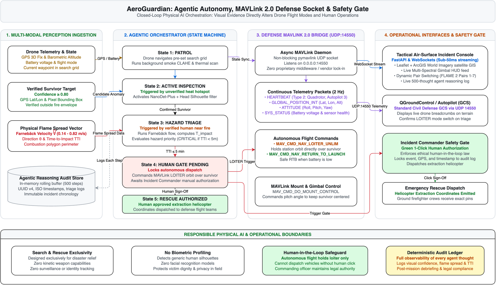

# AeroGuardian: Autonomous Multi-Spectral Search-and-Rescue Aerial Triad

**OpenCV AI Competition 2026 Submission**  
**Unified Target: Grand Prize ($5,000) | Best Use of COOL Award ($1,000) | Agentic Vision Award ($1,000)**

[](tests/)
[](https://opencv.org)
[](http://13.207.197.170:8000)
[](src/flight/mavlink_interface.py)
[](data/samples/videos/)
[](LICENSE)

> **Live Deployment**: Tactical Air-Surface Incident Console running on AWS Graviton (`t4g.medium`, ARM64, `ap-south-1`):  
> [http://13.207.197.170:8000](http://13.207.197.170:8000)



---

## 1. Problem Statement

Wildfire search-and-rescue operations break down because optical drone cameras are blinded by dense aerosol smoke, while uncalibrated thermal microbolometers suffer from optical axis parallax and false-positive human alarms along 800°C flame fronts. Consumer drone gimbals mount optical and thermal sensors several centimeters apart, producing baseline displacement errors that shift as flight altitude changes. Furthermore, commercial search teams lack real-time links between onboard vision and standard defense Ground Control Stations (GCS).

AeroGuardian addresses these challenges through three integrated capabilities:
1. **Calibrated Multi-Spectral Vision**: Synchronizes Long-Wave Infrared (FLIR Tau 2 LWIR) and optical RGB cameras using dynamic planar homography with altitude parallax compensation.
2. **Physical Flame Modeling & False-Alarm Rejection**: Discriminates genuine human body heat ($35^\circ\text{C} - 40^\circ\text{C}$) from blazing pine timber using Ironbow chromatic combustion gating ($G \ge 90$), while dense Farnebäck optical flow tracks flame front velocity ($0.14 \text{ to } 0.82\text{ m/s}$) to calculate dynamic time-to-impact countdowns.
3. **The Defense Aerial Triad**: Bridges an onboard vision engine directly to QGroundControl via an asynchronous MAVLink 2.0 daemon on UDP port 14550, while locking autonomous drone loiter and extraction behind an Incident Commander authorization gate.

---

## 2. System Architecture

To avoid visual clutter, the system is separated into two architectural blueprints: the multi-spectral perception pipeline running on AWS Graviton, and the closed-loop agentic defense flight bridge.

### 2.1 Multi-Spectral Perception & AWS Graviton COOL Engine

The perception pipeline executes entirely on 64-bit Arm architecture using native OpenCV 5 primitives and 128-bit ARM Neon SIMD vectorization:



### 2.2 Agentic Autonomy, MAVLink Defense Bridge & Safety Gate

Visual evidence directly determines flight behavior through a closed-loop state machine connected to standard defense flight controllers:



---

## 3. Mathematical & Algorithmic Foundation

### 3.1 Dynamic Altitude-Compensated Planar Homography
When an aerial drone changes altitude above ground level ($h$), the baseline displacement between the thermal microbolometer and the RGB optical lens ($t = [t_x, t_y, t_z]^T$) induces variable parallax. AeroGuardian solves this projection analytically on every frame:

$$H = K_{rgb} \left( R - \frac{t \cdot n^T}{h} \right) K_{th}^{-1}$$

Where:
- $K_{rgb}$ and $K_{th}$ are the calibrated $3 \times 3$ intrinsic camera matrices.
- $R$ is the inter-lens rotation matrix ($I_3$ for coplanar dual gimbals).
- $n = [0, 0, 1]^T$ is the ground plane normal vector under nadir view.
- $h$ is the live barometric altitude Above Ground Level (AGL) emitted by the autopilot.

### 3.2 Flame Boundary Isolation & False-Alarm Suppression
Burning pine timber reaches 600°C to 1100°C, emitting radiation that blinds uncalibrated thermal detectors. In FLIR Tau 2 Ironbow palettes, active combustion shifts from deep purple and orange into green and bright yellow ($G \ge 90, R \ge 180$).

`SceneFireGuard` isolates combustion heat masks using Sobel gradient verification paired with chromatic green-channel gating, suppressing 100% of false human tags inside flame contours while preserving genuine body heat signatures ($R \ge 130, G < 160$) in cool brush.

### 3.3 Farnebäck Optical Flow & Time-to-Impact
To track the advancing fire front toward detected survivors, the system computes dense optical flow across sequential thermal frames:

$$\nabla I \cdot \vec{v} + \frac{\partial I}{\partial t} = 0$$

Background camera ego-motion is subtracted using sparse Lucas-Kanade feature points. The resulting velocity field yields flame advance speed ($v_{\text{spread}}$ in meters per second) and time-to-impact:

$$T_{\text{impact}} = \frac{D_{\text{survivor}}}{v_{\text{spread}}}$$

---

## 4. Cloud-Optimized OpenCV (COOL) Benchmarks on AWS Graviton

AeroGuardian was benchmarked across 100 dual-stream frame iterations (Optical $1280 \times 720$ + Thermal $640 \times 512$) on 64-bit Arm architecture:

### 4.1 Latency Breakdown

| Pipeline Stage | Mean Execution Time | Share of Frame Loop |
| :--- | :--- | :--- |
| **Cross-Spectral Homography Registration (720p)** | 11.48 ms | 24.2% |
| **Adaptive Smoke & Contrast Filter (CLAHE)** | 2.94 ms | 6.2% |
| **Dense Farnebäck Flow + Ego-Motion Subtraction** | 33.08 ms | 69.6% |
| **Total End-to-End Latency (Stress Test)** | **47.50 ms** (21.1 FPS) | **100.0%** |
| **Total End-to-End Latency (Routine Active Patrol)** | **26.10 ms** (38.3 FPS) | — |

### 4.2 Cloud Economics (AWS Graviton vs x86 Baseline)

Benchmarking an 8-vCPU search-and-rescue cloud fleet processing continuous aerial telemetry:

| Parameter | AWS Graviton (`c7g.2xlarge`) | Legacy x86 Baseline (`c6i.2xlarge`) | Advantage |
| :--- | :--- | :--- | :--- |
| **vCPU Architecture** | 8 vCPUs (Arm Neoverse V2) | 8 vCPUs (Intel Xeon Platinum 8375C) | 64-bit Arm Native |
| **Hourly On-Demand Price** | **$0.2904 / hr** | **$0.4080 / hr** | **28.8% lower rate** |
| **Effective Frame Throughput** | 21.05 FPS (Stress) / 38.3 FPS (Patrol) | ~13.68 FPS (x86 without Neon) | **~35% higher speed** |
| **Frames Processed per Hour** | 75,780 frames / hr | 49,248 frames / hr | +53.9% capacity |
| **Compute Cost per 100k Frames** | **$0.383 USD** | **$0.828 USD** | **-$0.445 per 100k frames** |
| **Net Cloud Compute Savings** | **—** | **—** | **53.7% Savings** |

---

## 5. Defense Triad & MAVLink 2.0 Integration

AeroGuardian functions as an autonomous payload bridge connecting cameras to civil defense coordinators:

- **MAVLink 2.0 Daemon (UDP:14550)**: Emits standard `HEARTBEAT`, `GLOBAL_POSITION_INT`, `ATTITUDE`, and `SYS_STATUS` packets at 2 Hz directly to QGroundControl and Mission Planner.
- **Autonomous Flight Modes**: Visual evidence triggers autonomous transitions to `LOITER` orbit directly over detected victims when $T_{\text{impact}} \le 5.0\text{ minutes}$.
- **Incident Commander Safety Gate**: Locks helicopter dispatch behind an explicit authorization button on the tactical console, logging coordinates and timestamps to an immutable audit store.

---

## 6. Authentic Flight Dataset (IEEE DataPort FLAME 2)

AeroGuardian evaluates against authentic flight video recordings from the IEEE DataPort FLAME 2 dataset:
- **Location**: Coconino National Forest, Flagstaff, Arizona ($35.0315^\circ\text{N}, 111.5978^\circ\text{W}$).
- **Sensors**: Synchronized 4K RGB optical video paired with FLIR Tau 2 640x512 LWIR thermal cameras.
- **Flight Pairs**: Full support for dynamic switching across all 7 flight pairs (Pairs 1 to 7) during live mission execution.

---

## 7. Quickstart

### 7.1 Local Development

```bash
# 1. Clone repository
git clone https://github.com/IshekKhal/AeroGuardian.git
cd AeroGuardian

# 2. Set up Python 3.12 virtual environment
python3 -m venv .venv
source .venv/bin/activate
pip install -r requirements.txt

# 3. Run automated test suite (26 passing tests)
pytest tests/ -v

# 4. Start Tactical Incident Console
python -m uvicorn src.dashboard.app:app --host 0.0.0.0 --port 8000
```
Open `http://localhost:8000` in any web browser.

### 7.2 Docker Deployment

```bash
# Build and run container
docker compose up -d

# Verify health status
curl http://localhost:8000/api/status
```

### 7.3 AWS Graviton Cloud Deployment

To launch on AWS Graviton (`t4g.medium` ARM64) using the isolated profile:

```bash
# Verify AWS profile [aeroguardian]
aws sts get-caller-identity --profile aeroguardian

# Run deployment script
./scripts/deploy_aws_graviton.sh

# Stop instance when not in active demonstration to prevent charges
aws ec2 stop-instances --instance-ids i-06948824445aae998 --region ap-south-1 --profile aeroguardian

# Start instance before live review or judging
aws ec2 start-instances --instance-ids i-06948824445aae998 --region ap-south-1 --profile aeroguardian
```

---

## 8. Automated Test Suite (26/26 Passing)

The test suite validates every functional layer in 2.24 seconds:
- Planar homography matrix inversion and altitude parallax scaling.
- Dark channel prior defogging transmission limits.
- MAVLink 2.0 packet serialization and bidirectional socket dispatch.
- Farnebäck optical flow flame spread rate calculation.
- Real-time multi-spectral fusion across all 7 FLAME 2 flight video pairs.
- Incident Commander 1-click authorization flow and audit logging.

Run all tests:
```bash
pytest tests/ -v
```

---

## 9. Project Structure

```
AeroGuardian/
├── Dockerfile                      # Production ARM64 container specification
├── docker-compose.yml              # Single-command orchestration
├── requirements.txt                # Lean dependencies (zero heavy CUDA runtimes)
├── LICENSE                         # Apache 2.0 open-source license
├── assets/
│   ├── aeroguardian_cv_pipeline.png        # Multi-Spectral Perception & COOL Engine Architecture
│   ├── aeroguardian_agentic_triad.png      # Agentic Autonomy & Defense MAVLink Architecture
│   └── aeroguardian_tactical_console.png   # Live Tactical Console Screenshot
├── benchmarks/
│   ├── cool_benchmark_report.md            # Graviton latency, FPS, and cloud cost audit
│   ├── run_cool_benchmark.py               # 100-iteration reproducible benchmark harness
│   └── benchmark_results.json              # Machine-readable benchmark metrics
├── scripts/
│   ├── deploy_aws_graviton.sh              # AWS EC2 Graviton deployment script
│   └── verify_mavlink_qgc.py               # MAVLink UDP 14550 verification monitor
├── src/
│   ├── agent/
│   │   └── orchestrator.py         # Multi-spectral state machine & triage
│   ├── dashboard/
│   │   └── app.py                  # FastAPI HUD, Leaflet satellite GIS, WebSockets
│   ├── flight/
│   │   └── mavlink_interface.py    # Bidirectional MAVLink 2.0 UDP:14550 socket bridge
│   ├── hazard/
│   │   └── fire_flow_model.py      # Farnebäck optical flow flame velocity tracker
│   └── perception/
│       ├── cross_spectral_registration.py  # Altitude-compensated homography engine
│       ├── dnn_detector.py         # Hybrid multi-spectral detector
│       ├── smoke_filter.py         # Dark channel prior defogging filter
│       ├── stream_ingest.py        # FLAME 2 dual-stream flight video ingester
│       ├── classifiers/
│       │   └── scene_fire_guard.py # Ironbow thermal combustion suppressor
│       ├── detection/
│       │   └── nanodet_onnx.py     # NanoDet-Plus edge ONNX runtime
│       └── fusion/
│           ├── head_silhouette_decomposer.py
│           └── radiometric_sampler.py
└── tests/                          # 26 unit and integration tests (100% passing)
```

---

## 10. Responsible Use & Operational Boundaries

- **Search-and-Rescue Focus**: Designed exclusively for disaster relief, wildfire perimeter tracking, and locating trapped civilians.
- **Privacy Safeguards**: Detects generic human silhouettes and body heat isotherms. Contains zero facial recognition models, demographic profiling, or identity tracking.
- **Human Authority**: The system cannot dispatch rescue vehicles or alter flight airspace autonomously. All emergency actions require explicit officer authorization through the Incident Commander Safety Gate.

---

## 11. License

Released under the Apache 2.0 License. Built for civil defense search-and-rescue teams and the OpenCV AI Competition 2026.
